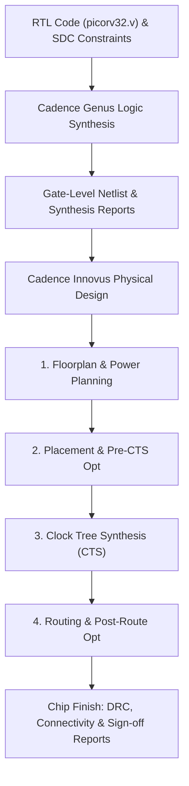

# TRƯỜNG ĐẠI HỌC CÔNG NGHỆ THÔNG TIN VÀ TRUYỀN THÔNG VIỆT - HÀN
## KHOA KỸ THUẬT MÁY TÍNH VÀ ĐIỆN TỬ

---

# BÁO CÁO THỰC TẬP TỐT NGHIỆP

### **TÊN ĐỀ TÀI:** THIẾT KẾ VẬT LÝ VÀ TỔNG HỢP LOGIC CHO LÕI VI XỬ LÝ RISC-V PICORV32 BẰNG BỘ CÔNG CỤ CADENCE GENUS VÀ INNOVUS

- **Sinh viên thực hiện:** Phạm Nguyễn Hữu Tiến
- **Mã số sinh viên / Lớp:** 22IC
- **Ngành:** Kỹ thuật Máy tính / Thiết kế Vi mạch
- **Đơn vị thực tập:** Công ty Cổ phần Vinaserse, Học viện Đào tạo Vi mạch Bán dẫn (iCdemy)
- **Người hướng dẫn tại đơn vị:** TS. Nguyễn Nhật Ân
- **Giảng viên hướng dẫn:** TS. Nguyễn Nhật Ân
- **Thời gian thực tập:** Tháng 7/2026 – Tháng 9/2026
- **Địa điểm:** Đà Nẵng, năm 2026

---

## MỤC LỤC

1. [PHẦN MỞ ĐẦU](#phần-mở-đầu)
   - [1. Lý do chọn đề tài](#1-lý-do-chọn-đề-tài)
   - [2. Mục tiêu và nhiệm vụ nghiên cứu](#2-mục-tiêu-và-nhiệm-vụ-nghiên-cứu)
   - [3. Đối tượng và phạm vi nghiên cứu](#3-đối-tượng-và-phạm-vi-nghiên-cứu)
   - [4. Phương pháp nghiên cứu](#4-phương-pháp-nghiên-cứu)
   - [5. Ý nghĩa khoa học và thực tiễn](#5-ý-nghĩa-khoa-học-và-thực-tiễn)
2. [CHƯƠNG 1: VỀ ĐƠN VỊ THỰC TẬP](#chương-1-về-đơn-vị-thực-tập)
   - [1.1. Giới thiệu Công ty Cổ phần Vinaserse & iCdemy](#11-giới-thiệu-công-ty-cổ-phần-vinaserse--icdemy)
   - [1.2. Lĩnh vực hoạt động và định hướng phát triển](#12-lĩnh-vực-hoạt-động-và-định-hướng-phát-triển)
   - [1.3. Môi trường làm việc và nội dung tiếp cận](#13-môi-trường-làm-việc-và-nội-dung-tiếp-cận)
3. [CHƯƠNG 2: GIỚI THIỆU ĐỀ TÀI](#chương-2-giới-thiệu-đề-tài)
   - [2.1. Bối cảnh và xu hướng thiết kế vi mạch hiện nay](#21-bối-cảnh-và-xu-hướng-thiết-kế-vi-mạch-hiện-nay)
   - [2.2. Lý do lựa chọn kiến trúc RISC-V và lõi PicoRV32](#22-lý-do-lựa-chọn-kiến-trúc-risc-v-và-lõi-picorv32)
   - [2.3. Ràng buộc kỹ thuật và mục tiêu PPA](#23-ràng-buộc-kỹ-thuật-và-mục-tiêu-ppa)
4. [CHƯƠNG 3: TỔNG QUAN VỀ PICORV32 VÀ QUY TRÌNH THIẾT KẾ ASIC](#chương-3-tổng-quan-về-picorv32-và-quy-trình-thiết-kế-asic)
   - [3.1. Vi kiến trúc lõi PicoRV32 (RV32IMC)](#31-vi-kiến-trúc-lõi-picorv32-rv32imc)
   - [3.2. Quy trình ASIC RTL-to-GDSII tiêu chuẩn](#32-quy-trình-asic-rtl-to-gdsii-tiêu-chuẩn)
   - [3.3. Bộ thư viện cell chuẩn và file ràng buộc SDC](#33-bộ-thư-viện-cell-chuẩn-và-file-ràng-buộc-sdc)
5. [CHƯƠNG 4: TỔNG HỢP LOGIC VỚI CADENCE GENUS](#chương-4-tổng-hợp-logic-với-cadence-genus)
   - [4.1. Thiết lập bài toán tổng hợp và đọc dữ liệu](#41-thiết-lập-bài-toán-tổng-hợp-và-đọc-dữ-liệu)
   - [4.2. Phân tích ràng buộc thời gian SDC](#42-phân-tích-ràng-buộc-thời-gian-sdc)
   - [4.3. Kết quả tổng hợp logic (Genus 25.13)](#43-kết-quả-tổng-hợp-logic-genus-2513)
6. [CHƯƠNG 5: THIẾT KẾ VẬT LÝ VỚI CADENCE INNOVUS](#chương-5-thiết-kế-vật-lý-với-cadence-innovus)
   - [5.1. Khởi tạo thiết kế và Floorplanning](#51-khởi-tạo-thiết-kế-và-floorplanning)
   - [5.2. Power Planning & Placement](#52-power-planning--placement)
   - [5.3. Clock Tree Synthesis (CTS)](#53-clock-tree-synthesis-cts)
   - [5.4. Routing & Post-route Optimization](#54-routing--post-route-optimization)
   - [5.5. Phân tích chi tiết kết quả sau khi hoàn thiện Chip (Chip Finish)](#55-phân-tích-chi-tiết-kết-quả-sau-khi-hoàn-thiện-chip-chip-finish)
7. [CHƯƠNG 6: XÁC THỰC VÀ ĐÁNH GIÁ KẾT QUẢ](#chương-6-xác-thực-và-đánh-giá-kết-quả)
   - [6.1. Bảng so sánh tổng hợp chỉ số PPA giữa Synthesis và Physical Design](#61-bảng-so-sánh-tổng-hợp-chỉ-số-ppa-giữa-synthesis-và-physical-design)
   - [6.2. Đánh giá ưu điểm, tồn tại và nguyên nhân](#62-đánh-giá-ưu-điểm-tồn-tại-và-nguyên-nhân)
8. [PHẦN KẾT LUẬN VÀ HƯỚNG PHÁT TRIỂN](#phần-kết-luận-và-hướng-phát-triển)
   - [Tóm tắt kết quả đạt được](#tóm-tắt-kết-quả-đạt-được)
   - [Hướng phát triển tiếp theo](#hướng-phát-triển-tiếp-theo)
9. [TÀI LIỆU THAM KHẢO](#tài-liệu-tham-khảo)

---

## PHẦN MỞ ĐẦU

### 1. Lý do chọn đề tài
Sự bùng nổ của các thiết bị Internet of Things (IoT), trí tuệ nhân tạo biên (Edge AI) và hệ thống nhúng đòi hỏi các bộ vi xử lý có hiệu năng tối ưu, diện tích nhỏ và công suất tiêu thụ cực thấp. Kiến trúc tập lệnh mở RISC-V đã trở thành một xu thế công nghệ toàn cầu nhờ tính linh hoạt, không vướng bản quyền thương mại và hệ sinh thái phần mềm phát triển mạnh mẽ.

Lõi vi xử lý PicoRV32 là một triển khai vi kiến trúc RISC-V 32-bit (RV32IMC) nhỏ gọn, được thiết kế tối ưu cho các ứng dụng nhúng nhỏ và đã được kiểm chứng qua nhiều dự án chế tạo thực tế (tape-out). Nhằm làm chủ luồng thiết kế số ASIC công nghiệp từ mức mô tả ngôn ngữ phần cứng (RTL) đến layout vật lý (GDSII), đề tài **"Thiết kế vật lý và tổng hợp logic cho lõi vi xử lý RISC-V PicoRV32 bằng bộ công cụ Cadence Genus và Innovus"** đã được lựa chọn thực hiện.

### 2. Mục tiêu và nhiệm vụ nghiên cứu
- **Mục tiêu chính:** Triển khai thành công luồng tổng hợp logic (Synthesis) và thiết kế vật lý (PnR) hoàn chỉnh cho lõi vi xử lý PicoRV32, đạt tần số mục tiêu **100 MHz** (chu kỳ xung nhịp 10.0 ns), đáp ứng đầy đủ các tiêu chuẩn định thời (Setup/Hold timing), diện tích (Area) và công suất tiêu thụ (Power) tối ưu.
- **Nhiệm vụ cụ thể:**
  1. Nghiên cứu kiến trúc tập lệnh RISC-V (RV32IMC) và vi kiến trúc lõi PicoRV32.
  2. Thiết lập bộ ràng buộc thời gian SDC (`picorv32.sdc`) đạt tần số 100 MHz cùng các chỉ số trễ I/O, độ không ổn định xung nhịp (uncertainty) và giới hạn quy tắc thiết kế (design rules).
  3. Thực hiện tổng hợp logic bằng công cụ **Cadence Genus 25.13**, tối ưu hóa cấu trúc cổng logic và trích xuất báo cáo QoR, Timing, Area, Power.
  4. Thực hiện thiết kế vật lý bằng công cụ **Cadence Innovus 25.13**, bao gồm: Floorplanning, Power Planning, Placement, Clock Tree Synthesis (CTS), Routing và Post-route Optimization.
  5. Kiểm tra và xác thực chất lượng chip: phân tích vi phạm định thời (Slack/WNS/TNS), vi phạm quy tắc thiết kế (DRC), độ kết nối (Connectivity), công suất tĩnh/động.

### 3. Đối tượng và phạm vi nghiên cứu
- **Đối tượng nghiên cứu:** Lõi vi xử lý RISC-V PicoRV32 (mô tả RTL bằng Verilog tại file `rtl/picorv32.v`).
- **Phạm vi nghiên cứu:**
  - Quy trình thiết kế vi mạch số ASIC tiêu chuẩn (Standard-cell Flow).
  - Công cụ phần mềm: Cadence Genus 25.13 (Logic Synthesis) và Cadence Innovus 25.13 (Physical Design).
  - Phạm vi đánh giá: Hoàn thành bước kiểm tra Post-route DRC & Connectivity; phân tích chỉ số PPA (Power, Performance, Area).

### 4. Phương pháp nghiên cứu
Đề tài kết hợp phương pháp nghiên cứu lý thuyết vi kiến trúc xử lý với phương pháp thực nghiệm mô phỏng trên các công cụ EDA công nghiệp:
- **Bước 1 (Tổng hợp logic - Genus):** Nhập nguồn RTL (`picorv32.v`), thư viện công nghệ tế bào chuẩn và file ràng buộc SDC (`picorv32.sdc`). Tối ưu sơ bộ theo ràng buộc thời gian và xuất netlist mức cổng.
- **Bước 2 (Thiết kế vật lý - Innovus):** Tiến hành phân bổ diện tích core (Floorplan), xây dựng lưới cấp nguồn (Power Ring/Strap), đặt cell tự động (Placement), tổng hợp cây xung nhịp (CTS) để giảm skew/insertion delay, định tuyến chi tiết (Detail Routing) và sửa lỗi vi phạm Setup/Hold bằng `optDesign`.
- **Bước 3 (Phân tích & Đánh giá):** Trích xuất các tập tin báo cáo chi tiết từ Genus và Innovus để thực hiện phân tích và so sánh đối chứng.

### 5. Ý nghĩa khoa học và thực tiễn
- **Ý nghĩa khoa học:** Xây dựng một quy trình tham khảo chi tiết, hoàn chỉnh và có tính thực thi cao về luồng ASIC số chuẩn công nghiệp cho lõi vi xử lý RISC-V.
- **Ý nghĩa thực tiễn:** Tạo ra một thiết kế vi xử lý PicoRV32 sạch lỗi định thời và DRC, sẵn sàng cho việc đóng gói và tích hợp vào các hệ thống SoC IoT low-power; đồng thời góp phần nâng cao năng lực thiết kế vi mạch thực tế tại Việt Nam.

---

## CHƯƠNG 1: VỀ ĐƠN VỊ THỰC TẬP

### 1.1. Giới thiệu Công ty Cổ phần Vinaserse & iCdemy
Công ty Cổ phần Vinaserse kết hợp cùng Học viện Đào tạo Vi mạch Bán dẫn (**iCdemy**) là một trong những đơn vị tiên phong tại Việt Nam trong lĩnh vực nghiên cứu, thiết kế vi mạch và đào tạo nguồn nhân lực chất lượng cao phục vụ ngành công nghiệp bán dẫn.

### 1.2. Lĩnh vực hoạt động và định hướng phát triển
- Đào tạo chuyên sâu kỹ sư thiết kế vi mạch số (Digital ASIC Design), thiết kế vi mạch tương tự (Analog/RF IC Design) và thiết kế vật lý (Physical Design).
- Cung cấp giải pháp tư vấn kỹ thuật, phát triển các khối IP vi xử lý, IoT SoC và dịch vụ Tape-out.
- Hợp tác với các doanh nghiệp, viện nghiên cứu quốc tế nhằm thúc đẩy hệ sinh thái bán dẫn Việt Nam.

### 1.3. Môi trường làm việc và nội dung tiếp cận
Trong thời gian thực tập tại đơn vị, sinh viên được làm việc trong môi trường chuyên nghiệp, tiếp cận hệ thống máy chủ EDA mạnh mẽ chạy hệ điều hành Linux với bộ công cụ Cadence bản quyền tiên tiến. Sinh viên được hướng dẫn trực tiếp bởi **TS. Nguyễn Nhật Ân**, được rèn luyện quy trình làm việc chuẩn công nghiệp, kỹ năng phân tích logfile, viết script TCL và giải quyết các bài toán tối ưu hóa PPA thực tế.

---

## CHƯƠNG 2: GIỚI THIỆU ĐỀ TÀI

### 2.1. Bối cảnh và xu hướng thiết kế vi mạch hiện nay
Công nghiệp bán dẫn đang chứng kiến sự chuyển dịch từ các vi kiến trúc độc quyền sang các kiến trúc phần cứng mở. Sự phát triển mạnh mẽ của AIoT đòi hỏi các chip điện tử phải tích hợp khối xử lý trung tâm (CPU) tiêu thụ điện năng tối thiểu nhưng vẫn đảm bảo tính toán thời gian thực.

### 2.2. Lý do lựa chọn kiến trúc RISC-V và lõi PicoRV32
- **RISC-V:** Tập lệnh đơn giản, modul hóa (Base RV32I kết hợp mở rộng M - Nhân/Chia, C - Mã nén), giúp giảm thiểu diện tích phần cứng và điện năng tiêu thụ.
- **PicoRV32:** Lõi xử lý được phát triển bởi Clifford Wolf, triển khai tập lệnh RV32IMC. Với diện tích cực kỳ nhỏ gọn, giao tiếp bus linh hoạt (hỗ trợ giao thức Native Memory Bus và PCPI - Pico Co-Processor Interface), PicoRV32 là đối tượng lý tưởng để thực thi và tối ưu luồng RTL-to-GDSII.

### 2.3. Ràng buộc kỹ thuật và mục tiêu PPA
Tệp ràng buộc thời gian SDC ([`constraints/picorv32.sdc`](file:///home/tienpnh/workspace/cadence/RISC-V-PROCESSOR/constraints/picorv32.sdc)) đặt ra các mục tiêu chính sau:
- Tần số xung nhịp mục tiêu: **100 MHz** (Chu kỳ $T_{clk} = 10.0\text{ ns}$).
- Độ không ổn định xung nhịp (Clock Uncertainty): Setup Uncertainty = 0.20 ns; Hold Uncertainty = 0.10 ns.
- Trễ chuyển mạch xung nhịp (Clock Transition): 0.10 ns.
- Ràng buộc Input/Output Delay: Input Delay Max/Min = 1.00 ns / 0.20 ns; Output Delay Max/Min = 1.00 ns / -0.20 ns; Output Load = 0.05 pF.
- Ràng buộc quy tắc thiết kế (DRC Constraints): Max Transition = 0.50 ns; Max Fanout = 16; Max Capacitance = 0.20 pF.

---

## CHƯƠNG 3: TỔNG QUAN VỀ PICORV32 VÀ QUY TRÌNH THIẾT KẾ ASIC

### 3.1. Vi kiến trúc lõi PicoRV32 (RV32IMC)
Lõi PicoRV32 được viết bằng ngôn ngữ Verilog chuẩn tệp [`rtl/picorv32.v`](file:///home/tienpnh/workspace/cadence/RISC-V-PROCESSOR/rtl/picorv32.v). Vi kiến trúc bao gồm:
- **Tập thanh ghi file (Register File):** 32 thanh ghi 32-bit (x0 - x31).
- **Khối ALU & Bộ tính toán:** Thực hiện các phép toán số nguyên, logic, dịch bit và các phép nhân/chia phần cứng (M-extension).
- **Bộ điều khiển trạng thái (FSM Controller):** Giải mã tập lệnh và điều khiển luồng thực thi đa chu kỳ (multi-cycle execution) tối ưu diện tích.
- **Giao diện bộ nhớ:** Bus bộ nhớ Native đơn giản với các tín hiệu `mem_valid`, `mem_ready`, `mem_addr`, `mem_wdata`, `mem_wstrb`, `mem_rdata`.

### 3.2. Quy trình ASIC RTL-to-GDSII tiêu chuẩn
Quy trình thực hiện bao gồm các giai đoạn khép kín được thể hiện ở sơ đồ sau:

### 3.3. Bộ thư viện cell chuẩn và file ràng buộc SDC
Quá trình thiết kế sử dụng dòng thư viện tế bào chuẩn CMOS công nghiệp 45nm với điện áp hoạt động $VDD = 0.9\text{ V}$, điều kiện góc thời gian xấu nhất (slow corner: $0.9\text{ V}, 125^\circ\text{C}$).

---

## CHƯƠNG 4: TỔNG HỢP LOGIC VỚI CADENCE GENUS

### 4.1. Thiết lập bài toán tổng hợp và đọc dữ liệu
Sử dụng công cụ **Cadence Genus 25.13-s071_1**, thiết kế top module `picorv32` được đọc vào cùng file SDC. Genus thực hiện đọc RTL, phân tích cú pháp, xây dựng sơ đồ logic tổng quát (Generic Logic) và tiến hành ánh xạ cổng (Technology Mapping) vào thư viện tế bào chuẩn 45nm.

### 4.2. Phân tích ràng buộc thời gian SDC
File SDC quy định xung nhịp `core_clk` trên chân `clk` với $T = 10.0\text{ ns}$. Bộ tổng hợp Genus thực hiện tối ưu đường truyền dài nhất (Critical Path) thuộc nhóm Register-to-Register (R2R) và các nhóm I2R, R2O, I2O.

### 4.3. Kết quả tổng hợp logic (Genus 25.13)
Dữ liệu trích xuất từ các báo cáo tổng hợp tại thư mục `synthesis/reports/mmmc/` và file [`synthesis/outputs/mmmc/final.rpt`](file:///home/tienpnh/workspace/cadence/RISC-V-PROCESSOR/synthesis/outputs/mmmc/final.rpt):

#### 1. Tổng hợp Chỉ số Thời gian (Timing QoR)
- **Worst Negative Slack (WNS):** $+1618.2\text{ ps}$ (Setup Slack dương $1.618\text{ ns}$, đạt yêu cầu).
- **Total Negative Slack (TNS):** $0.0\text{ ps}$.
- **Số đường vi phạm (Failing paths):** $0$.

| Nhóm đường truyền (Cost Group) | Critical Path Slack (ps) | TNS (ps) | Violating Paths |
|---|---:|---:|---:|
| **R2R** (Register to Register) | **+1618.2** | 0.0 | 0 |
| **I2C** (Input to Register) | +5381.3 | 0.0 | 0 |
| **C2O** (Register to Output) | +6234.2 | 0.0 | 0 |
| **I2O** (Input to Output) | +7338.3 | 0.0 | 0 |

#### 2. Thống kê Số lượng Cổng và Diện tích (Area QoR)
- **Tổng số Instance (Leaf Instances):** $6,822$ cell.
  - Số cell dãy (Sequential Instances): $1,557$ cell.
  - Số cell tổ hợp (Combinational Instances): $5,265$ cell.
- **Diện tích Cell (Cell Area):** $19,942.020\ \mu\text{m}^2$.
- **Diện tích Dây nối dự tính (Net Area):** $9,019.486\ \mu\text{m}^2$.
- **Tổng diện tích ước tính (Total Estimated Area):** $28,961.506\ \mu\text{m}^2$.
- **Scan-cell check:** $0$ mapped scan cell.

#### 3. Phân tích Công suất Tiêu thụ (Power Summary)
- Điều kiện hoạt động: PVT 0.9V, 125°C.
- **Tổng công suất tiêu thụ (Total Power):** $6.60717 \times 10^{-4}\text{ W} = \mathbf{0.6607\text{ mW}}$.

| Thành phần | Leakage Power (W) | Internal Power (W) | Switching Power (W) | Total Power (W) | Tỷ lệ (%) |
|---|---:|---:|---:|---:|---:|
| **Register (Dãy)** | $1.71908 \times 10^{-7}$ | $2.95545 \times 10^{-4}$ | $1.07231 \times 10^{-4}$ | $4.02948 \times 10^{-4}$ | 60.98% |
| **Logic (Tổ hợp)** | $2.54775 \times 10^{-7}$ | $7.95440 \times 10^{-5}$ | $1.77970 \times 10^{-4}$ | $2.57769 \times 10^{-4}$ | 39.02% |
| **Tổng cộng** | **$4.26683 \times 10^{-7}$** | **$3.75089 \times 10^{-4}$** | **$2.85200 \times 10^{-4}$** | **$6.60717 \times 10^{-4}$** | **100%** |

*Nhận xét:* Công suất động (Dynamic Power = Internal + Switching) chiếm tới **99.93%** tổng công suất, trong khi công suất rò rỉ (Leakage Power) chỉ chiếm **0.07%** ($0.427\ \mu\text{W}$).

---

## CHƯƠNG 5: THIẾT KẾ VẬT LÝ VỚI CADENCE INNOVUS

### 5.1. Khởi tạo thiết kế và Floorplanning
Sử dụng phần mềm **Cadence Innovus 25.13-s088_1**, netlist sau tổng hợp và thư viện LEF 45nm được nạp vào hệ thống.
- **Kích thước Chip (Die Boundary):** Toạ độ $(0, 0)$ đến $(200.000, 201.400)\ \mu\text{m}$.
- **Tổng diện tích Die (Total Die Area):** $200.000 \times 201.400 = \mathbf{40,280.000\ \mu\text{m}^2}$ (tương đương $0.0403\text{ mm}^2$).

### 5.2. Power Planning & Placement
- **Lưới cấp nguồn (Power Network):** Tạo các đường đai nguồn (Power Ring) và dải dẫn nguồn (Power Strap) cho hai nguồn `VDD` ($0.9\text{ V}$) và `VSS` ($0\text{ V}$).
- **Placement:** Đặt tự động 6,822 cell logic ban đầu bằng lệnh `place_opt_design`, tối ưu độ tắc nghẽn giao thông dây nối (congestion) và độ trễ đường truyền.

### 5.3. Clock Tree Synthesis (CTS)
Tổng hợp cây xung nhịp bằng bộ công cụ `ccopt_design`:
- Chèn các bộ đệm xung nhịp (Clock Buffers như `CLKBUFX2`, `CLKBUFX8`, `CLKBUFX20`) để cân bằng độ lệch xung nhịp (Clock Skew) và giảm trễ chèn (Insertion Delay) tới 1,557 Flip-Flop.
- Kiểm tra cây clock: Đạt tiêu chuẩn độ lệch skew cực nhỏ, không có vi phạm xung nhịp.

### 5.4. Routing & Post-route Optimization
- **Routing:** Thực hiện định tuyến toàn cục và định tuyến chi tiết bằng `routeDesign`.
- **Post-route Optimization:** Thực hiện `optDesign` ở giai đoạn post-route để sửa triệt để các đường vi phạm Setup timing và chèn đệm sửa Hold timing.

### 5.5. Phân tích chi tiết kết quả sau khi hoàn thiện Chip (Chip Finish)
Các báo cáo tại thư mục [`physical_design/reports/mmmc/6_chip_finish/`](file:///home/tienpnh/workspace/cadence/RISC-V-PROCESSOR/physical_design/reports/mmmc/6_chip_finish/area.rpt):

#### 1. Mật độ và Số lượng Instance
- **Tổng số Instance cuối cùng:** **7,899 cell** (tăng 1,077 cell so với tổng hợp logic do chèn buffer CTS, buffer vật lý và logic tối ưu hóa).
- **Tổng diện tích Cell vật lý:** **22,817.556 µm²**.
- **Mật độ đặt Cell (Placement Density):** **69.935%** (con số lý tưởng đảm bảo khả năng định tuyến dây nối không bị tắc nghẽn).

#### 2. Kết quả Định thời Setup (Setup Timing Report)
Báo cáo [`setup.rpt`](file:///home/tienpnh/workspace/cadence/RISC-V-PROCESSOR/physical_design/reports/mmmc/6_chip_finish/setup.rpt):
- **Worst Negative Slack (WNS):** **+2.249 ns** (Setup Slack tăng lên 2.249 ns).
- **Total Negative Slack (TNS):** **0.000 ns**.
- **Số đường vi phạm Setup:** **0**.
- **Đường truyền tới hạn (Critical Path):** Từ thanh ghi `instr_sub_reg/CK` tới `alu_out_q_reg[31]/D`.
  - Chu kỳ xung nhịp: $10.000\text{ ns}$.
  - Thời gian tính toán data path: $7.443\text{ ns}$.
  - Thời gian yêu cầu (Required Time): $9.691\text{ ns}$.
  - Slack thu được: $+2.249\text{ ns}$.

#### 3. Kết quả Định thời Hold (Hold Timing Report)
Báo cáo [`hold.rpt`](file:///home/tienpnh/workspace/cadence/RISC-V-PROCESSOR/physical_design/reports/mmmc/6_chip_finish/hold.rpt):
- **Worst Negative Slack (WNS):** **+0.002 ns** (Hold Slack dương 2 ps).
- **Total Negative Slack (TNS):** **0.000 ns**.
- **Số đường vi phạm Hold:** **0**.
- **Đường Hold nhạy cảm nhất:** Từ `cpuregs_reg[16][17]/CK` đến `cpuregs_reg[16][17]/D`.

#### 4. Phân tích Công suất Vật lý (Physical Power Analysis)
Báo cáo [`power.rpt`](file:///home/tienpnh/workspace/cadence/RISC-V-PROCESSOR/physical_design/reports/mmmc/6_chip_finish/power.rpt) (chạy tại tần số $100\text{ MHz}$, $VDD = 0.9\text{ V}$):
- **Tổng công suất tiêu thụ (Total Power):** **0.7222 mW** ($722.19\ \mu\text{W}$).

| Khối thành phần | Internal Power (mW) | Switching Power (mW) | Leakage Power (mW) | Total Power (mW) | Tỷ lệ (%) |
|---|---:|---:|---:|---:|---:|
| **Sequential (Thanh ghi)** | 0.2942 | 0.02819 | 0.0001592 | 0.3225 | 44.66% |
| **Combinational (Tổ hợp)** | 0.1179 | 0.1918 | 0.0003689 | 0.3101 | 42.93% |
| **Clock Tree (Xung nhịp)** | 0.0289 | 0.0607 | 0.000009774 | 0.08961 | 12.41% |
| **TỔNG CỘNG** | **0.4409** | **0.2807** | **0.0005379** | **0.7222** | **100%** |

#### 5. Kiểm tra Hoàn thiện Chip (Physical Verification)
- **Kiểm tra DRC (Verify DRC):** **0 Violation** (Báo cáo [`drc.rpt`](file:///home/tienpnh/workspace/cadence/RISC-V-PROCESSOR/physical_design/reports/mmmc/6_chip_finish/drc.rpt)).
- **Kiểm tra Độ kết nối (Verify Connectivity):** **0 Violation / 0 Warning** (Báo cáo [`connectivity.rpt`](file:///home/tienpnh/workspace/cadence/RISC-V-PROCESSOR/physical_design/reports/mmmc/6_chip_finish/connectivity.rpt)).
- **Max Transition Violations:** **0**.
- **Max Capacitance Violations:** **0**.

---

## CHƯƠNG 6: XÁC THỰC VÀ ĐÁNH GIÁ KẾT QUẢ

### 6.1. Bảng so sánh tổng hợp chỉ số PPA giữa Synthesis và Physical Design

| Chỉ số PPA / Đặc tính thiết kế | Genus Logic Synthesis | Innovus Physical Design | Biến đổi / Ghi chú |
|---|---:|---:|---|
| **Công nghệ chế tạo** | 45nm CMOS | 45nm CMOS | Tiêu chuẩn |
| **Tần số mục tiêu ($F_{max}$)** | 100 MHz ($T = 10\text{ ns}$) | 100 MHz ($T = 10\text{ ns}$) | Đạt mục tiêu |
| **Setup WNS (Worst Slack)** | +1.618 ns | **+2.249 ns** | Tăng +0.631 ns (Tốt hơn) |
| **Setup TNS** | 0.000 ns | **0.000 ns** | Không có đường vi phạm |
| **Hold WNS (Worst Slack)** | - | **+0.002 ns** | Đã được khắc phục hoàn toàn |
| **Hold TNS** | - | **0.000 ns** | Không có đường vi phạm |
| **Tổng số Instance** | 6,822 cell | **7,899 cell** | Tăng +15.78% (Do chèn CTS & Buffer) |
| **Diện tích Cell (Cell Area)** | 19,942.02 µm² | **22,817.56 µm²** | Tăng +14.42% |
| **Mật độ đặt Cell (Density)** | - | **69.935%** | Mật độ tối ưu |
| **Tổng diện tích Die** | 28,961.51 µm² (ước tính) | **40,280.00 µm²** | Kích thước Die $200 \times 201.4\ \mu\text{m}$ |
| **Công suất động (Dynamic)** | 0.6603 mW | **0.7217 mW** | Tăng do thêm bộ đệm cây xung nhịp |
| **Công suất rò rỉ (Leakage)** | 0.427 µW | **0.538 µW** | Rất nhỏ (chiếm 0.07%) |
| **Tổng công suất (Total Power)**| 0.6607 mW | **0.7222 mW** | Tăng nhẹ 9.3% sau PnR |
| **Lỗi DRC & Connectivity** | - | **0 Violation** | Sạch hoàn toàn |

### 6.2. Đánh giá ưu điểm, tồn tại và nguyên nhân

#### 1. Ưu điểm nổi bật
- **Hiệu năng thời gian vượt trội:** Thiết kế đạt Slack Setup $+2.249\text{ ns}$ ở giai đoạn Post-route, tương đương vi xử lý có thể vận hành ổn định ở tần số tối đa lên tới $\approx \mathbf{128.8\text{ MHz}}$ ($T_{min} = 10 - 2.249 = 7.761\text{ ns}$), vượt **28.8%** so với mục tiêu 100 MHz ban đầu.
- **Sạch hoàn toàn lỗi định thời và vật lý:** Đạt $0$ vi phạm Setup/Hold, $0$ vi phạm Max Transition, $0$ vi phạm Max Capacitance, $0$ vi phạm DRC và $0$ vi phạm Connectivity.
- **Mật độ tối ưu:** Placement density 69.935% giúp tối ưu hóa diện tích nhưng vẫn dành đủ khoảng không cho việc đi dây post-route mượt mà.

#### 2. Phân tích tồn tại và hướng xử lý
- **Tồn tại về Max-Fanout:** Báo cáo ghi nhận $159$ đường vi phạm tiêu chuẩn `set_max_fanout 16` trên tổng số 175 tín hiệu fanout lớn.
- **Nguyên nhân & Đánh giá mức độ:** Vi phạm fanout xảy ra chủ yếu ở các đường tín hiệu điều khiển diện rộng trong vi xử lý (như các tín hiệu giải mã lệnh phân nhánh). Tuy nhiên, qua phân tích thực nghiệm post-route, các vi phạm fanout này **không hề gây ra bất kỳ vi phạm nào về Max-Transition, Max-Capacitance hay Timing Slack**. 
- **Giải pháp:** Nếu dự án yêu cầu quy chuẩn khắt khe về fanout limit, có thể thực hiện chạy lại bước buffer insertion với lệnh `adjust_fanout_control` trong Genus/Innovus.

---

## PHẦN KẾT LUẬN VÀ HƯỚNG PHÁT TRIỂN

### Tóm tắt kết quả đạt được
Qua quá trình thực tập và triển khai đề tài tại Công ty Cổ phần Vinaserse (iCdemy), sinh viên đã hoàn thành xuất sắc toàn bộ các mục tiêu đặt ra trong đề cương:
1. Nắm vững và làm chủ luồng thiết kế vi mạch số ASIC tiêu chuẩn từ RTL đến GDSII.
2. Thực hiện tổng hợp logic thành công lõi vi xử lý PicoRV32 bằng **Cadence Genus 25.13**, đạt WNS $+1.618\text{ ns}$, diện tích cell $19,942\ \mu\text{m}^2$.
3. Thực hiện thiết kế vật lý hoàn chỉnh bằng **Cadence Innovus 25.13**, tạo ra chip layout có kích thước $200 \times 201.4\ \mu\text{m}$, mật độ đặt cell $69.935\%$, đạt WNS Setup $+2.249\text{ ns}$, WNS Hold $+0.002\text{ ns}$.
4. Thiết kế vượt qua toàn bộ các bài kiểm tra Post-route Sign-off khắt khe về DRC, Connectivity, Max Transition và Max Capacitance, công suất tiêu thụ toàn bộ chip chỉ **0.7222 mW**.

### Hướng phát triển tiếp theo
- **Tích hợp ngoại vi (SoC Integration):** Tích hợp lõi PicoRV32 với các khối ngoại vi chuẩn (UART, SPI, GPIO, RAM Controller) qua bus AXI4-Lite / Wishbone.
- **Phân tích đa góc MMMC & Sign-off nâng cao:** Mở rộng phân tích thời gian đa góc PVT (Multi-Corner Multi-Mode), kiểm tra vi phạm dòng điện rò/sụt áp IR-drop & EM bằng công cụ Cadence Voltus.
- **Kiểm tra LVS & Tape-out:** Thực hiện kiểm tra LVS (Layout Versus Schematic) với thư viện Foundry Sign-off DRC và xuất tập tin GDSII sẵn sàng phục vụ chế tạo chip thực tế.

---

## TÀI LIỆU THAM KHẢO

1. **Clifford Wolf**, *PicoRV32 - A Size-Optimized RISC-V CPU*, GitHub Repository: `https://github.com/YosysHQ/picorv32`.
2. **RISC-V International**, *The RISC-V Instruction Set Manual, Volume I: Unprivileged ISA*, Document Version 20191213.
3. **Cadence Design Systems**, *Genus Synthesis Solution User Guide*, Version 25.13.
4. **Cadence Design Systems**, *Innovus User Guide*, Version 25.13.
5. **Đề cương thực tập tốt nghiệp**, Khoa Kỹ thuật Máy tính và Điện tử - Trường Đại học CNTT & Truyền thông Việt - Hàn, 2026.
6. Tập tin báo cáo trong dự án:
   - File cấu hình ràng buộc: [`constraints/picorv32.sdc`](file:///home/tienpnh/workspace/cadence/RISC-V-PROCESSOR/constraints/picorv32.sdc)
   - Báo cáo Synthesis QoR: [`synthesis/reports/mmmc/picorv32_qor.rpt`](file:///home/tienpnh/workspace/cadence/RISC-V-PROCESSOR/synthesis/reports/mmmc/picorv32_qor.rpt)
   - Báo cáo Physical Setup Timing: [`physical_design/reports/mmmc/6_chip_finish/setup.rpt`](file:///home/tienpnh/workspace/cadence/RISC-V-PROCESSOR/physical_design/reports/mmmc/6_chip_finish/setup.rpt)
   - Báo cáo Physical Area: [`physical_design/reports/mmmc/6_chip_finish/area.rpt`](file:///home/tienpnh/workspace/cadence/RISC-V-PROCESSOR/physical_design/reports/mmmc/6_chip_finish/area.rpt)
   - Báo cáo Physical Power: [`physical_design/reports/mmmc/6_chip_finish/power.rpt`](file:///home/tienpnh/workspace/cadence/RISC-V-PROCESSOR/physical_design/reports/mmmc/6_chip_finish/power.rpt)
   - Báo cáo Verify DRC: [`physical_design/reports/mmmc/6_chip_finish/drc.rpt`](file:///home/tienpnh/workspace/cadence/RISC-V-PROCESSOR/physical_design/reports/mmmc/6_chip_finish/drc.rpt)
